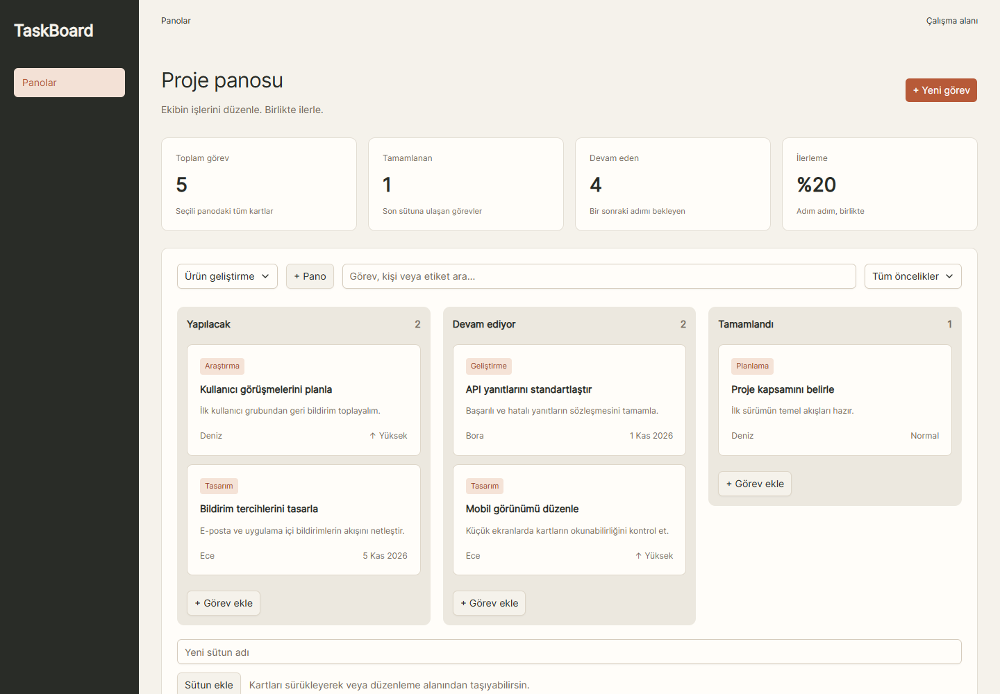

# TaskBoard

Fikirden tamamlanana. Ekibin için sade bir Kanban çalışma alanı.

**Angular 22 + TypeScript · .NET 10 · ASP.NET Core · Entity Framework Core · Npgsql · PostgreSQL 17**



[Telefon görünümü](docs/mobile.png)

## Arayüz

**Spartan UI** · Taş ve kiremit tonları, koyu proje şeridi ve Kanban sütunları. Tema sınırları ve doğrulama notları: [Arayüz sistemi](docs/ui.md).

## Özellikler

- Birden fazla pano ve özel sütunlar
- Kart oluşturma, düzenleme, silme ve sürükleyerek taşıma
- Klavye ile sütun seçimi, etiket, görevli, öncelik ve son tarih
- Arama, öncelik filtresi ve ilerleme özeti
- Farklı panolar arasında yanlış kart taşımaya karşı kontrol

## Çalıştırma

Gereksinimler: Node.js 22.22.3+, .NET SDK 10.0.403+ (10.0.x), Docker Compose.

```sh
git clone https://github.com/hassanbera/taskboard-dotnet.git
cd taskboard-dotnet
docker compose up -d --wait
```

API için bir terminal:

```sh
dotnet run --project backend/App.csproj
```

SDK sürümü global.json içinde tanımlıdır; NuGet bağımlılıkları packages.lock.json ile sabitlenmiştir.

Arayüz için ikinci terminal (repo kökünden):

```sh
cd frontend
npm ci
npm start
```

- Arayüz: http://localhost:5202
- API: http://127.0.0.1:4202/api
- Veritabanı: localhost:55502
- Sağlık: http://127.0.0.1:4202/api/health

API ilk açılışta sürümlenmiş EF Core migrationlarını uygular. İkinci migration yalnızca ilk kurulumda kurgusal demo verilerini ekler; sonraki açılışlarda mevcut kayıtlar korunur. `docker compose down` servisi durdurur ve verileri volume içinde korur.

## Mimari

```text
frontend/src/             Angular standalone bileşeni, tipler ve HTTP istemcisi
backend/
  Model/                 Veri modelleri
  Repository/            EF Core ve PostgreSQL erişimi
  Service/               İş kuralları ve transactionlar
  Controller/            HTTP giriş / çıkış
  Common/                Doğrulama ve hata yanıtları
database/                 Okunabilir sürümlenmiş SQL
tests/api.test.mjs         Gerçek HTTP + PostgreSQL testleri
scripts/test.mjs           İzole test veritabanı ve API süreç yönetimi
```

Controller → Service → Repository → EF Core → PostgreSQL. Controller veritabanına erişmez. İlişkiler SQL içinde foreign key ve indekslerle, EF Core içinde model eşlemeleriyle korunur. İş kuralları service katmanındadır.

## API

Başarılı yanıtlar `{"data": ...}`; iş kuralı hataları `{"error": "..."}` biçimindedir. Geçersiz girdi 400, eksik kayıt 404, çakışma 409 döndürür. Framework seviyesindeki bozuk istekler standart HTTP hata yanıtı kullanabilir.

| Yöntem | Yol |
| --- | --- |
| GET | /api/health |
| GET | /api/boards |
| POST | /api/boards |
| GET | /api/boards/{id} |
| POST | /api/boards/{id}/stages |
| POST | /api/cards |
| PUT | /api/cards/{id} |
| PATCH | /api/cards/{id}/move |
| DELETE | /api/cards/{id} |

Örnek istek ve kritik senaryolar [tests/api.test.mjs](tests/api.test.mjs) içinde çalıştırılabilir biçimde bulunur.

## Doğrulama

Repo kökünde:

```sh
npm test
```

Test scripti kendi rastgele isimli veritabanını oluşturur, backend'i derler, ayrı bir portta başlatır ve HTTP testlerini çalıştırır. Sonunda yalnızca kendi oluşturduğu test veritabanını kaldırır. Geliştirme kayıtlarına dokunmaz. Docker çalışıyor olmalıdır. Sunucu çıktısı `test-results/server.log` dosyasına yazılır. DOTNET_CMD ortam değişkeni farklı bir dotnet çalıştırıcısı seçebilir.

Üretim derlemeleri:

```sh
dotnet build backend/App.csproj --locked-mode
```

```sh
cd frontend
npm run build
```

## Yapılandırma

`DB_CONNECTION` (yerel PostgreSQL bağlantısı; port 55502) ve `APP_URLS` (varsayılan `http://127.0.0.1:4202`). Yerel Compose hesabı `app`, parolası `local-development-only` değeridir; bunlar sadece yerel geliştirme içindir. Dağıtımda environment secret kullan.

Kartlar hedef sütunun sonuna gider; sütun içi özel sıralama bulunmaz. İlerleme, son sütundaki kartların tüm kartlara oranıdır. Görevli alanı serbest metindir.

Bu sürüm tek çalışma alanlıdır; giriş ve kullanıcı bazında yetkilendirme içermez. API ve geliştirme arayüzü varsayılan olarak localhost üzerinde dinler. Üretim için kimlik doğrulama ve yetkilendirme ekle, Angular `frontend/dist/browser` çıktısını statik sun, aynı origin altındaki `/api` isteklerini backend'e yönlendir. Backend'in ağ dinleme adresini dağıtım ortamında açıkça yapılandır.

CI örneği [docs/ci.yml](docs/ci.yml) içinde bulunur. GitHub Actions workflow yazma yetkili bir oturumda `.github/workflows/ci.yml` yoluna taşıyarak etkinleştirilebilir.
